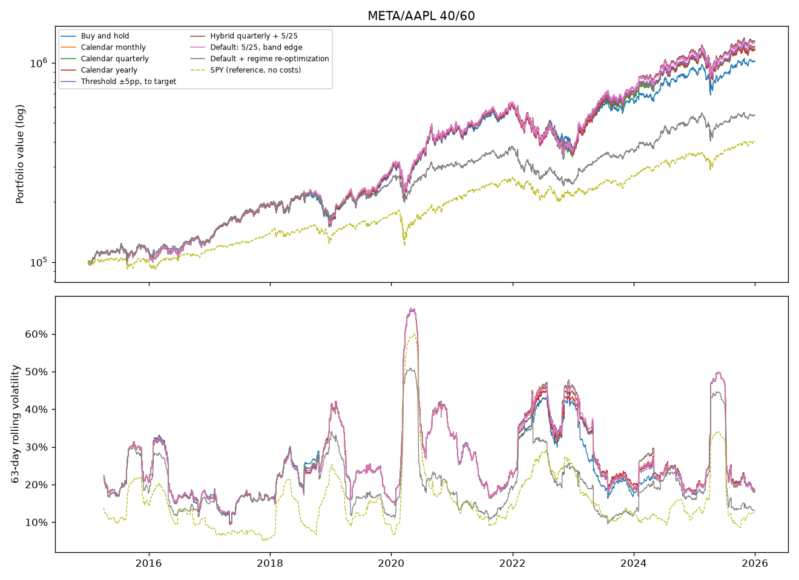
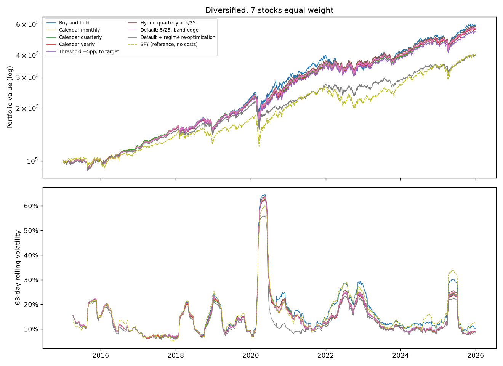

# Backtest results

Rebalancing policies compared on real data, 2015-01-02 to 2025-12-31.
Reproduce with `.venv/bin/python lib/examples/demo.py` (see the README).

## Setup

* **Prices**: Yahoo Finance daily closes adjusted for splits and dividends
  (total return), cached under `data/`. **Risk-free rate**: FRED `DTB3`
  (3-month T-bill). **Benchmark**: SPY.
* 100,000 initial cash, invested on the first day. Every trading day each
  policy is asked for a plan, and the plan is filled at that day's close.
* Costs: 1 USD per order + 5bps of traded value. Whole shares.
* Sector risk snapshots (252-day window) are recorded on the first trading
  day of each month; every lookup is point-in-time.
* "Default + regime re-optimization": when the regime trigger fires (risk-free
  rate moved 100bps or more, or a sector's beta, volatility or rate
  sensitivity changed beyond its threshold since the target was built), the
  target is rebuilt as inverse-volatility under a 20% volatility target and
  traded to. Its target therefore differs from the others' after the first
  re-optimization.

## Metrics

* **Vol of 63d vol**: standard deviation of the 63-day rolling annualized
  volatility. Lower means more stable risk, which is the objective.
* **Days within ±2pp of vol**: share of days whose rolling volatility is
  within 2 percentage points of the full-period volatility.
* **Avg distance to target**: half the sum of absolute differences between
  current and target weights (cash included), i.e. the fraction of the
  portfolio that sits in the wrong place, averaged over all days.
* **Turnover / yr**: traded value divided by the average portfolio value, per year.
* Sharpe uses daily excess returns over `DTB3`.

## Results

### META/AAPL 40/60

| Policy | CAGR | Volatility | Sharpe | Max drawdown | Vol of 63d vol | Days within ±2pp of vol | Avg distance to target | Rebalances | Trades | Turnover / yr | Costs | Re-optimizations |
|---|--:|--:|--:|--:|--:|--:|--:|--:|--:|--:|--:|--:|
| Buy and hold | 23.43% | 27.47% | 0.83 | -40.32% | 10.22% | 9% | 8.11% | 1 | 2 | 2% | 52 | 0 |
| Calendar monthly | 25.18% | 28.19% | 0.87 | -47.78% | 10.59% | 7% | 1.15% | 132 | 247 | 45% | 1,309 | 0 |
| Calendar quarterly | 24.98% | 28.20% | 0.86 | -48.13% | 10.58% | 8% | 2.09% | 44 | 85 | 30% | 773 | 0 |
| Calendar yearly | 24.87% | 28.09% | 0.86 | -44.62% | 10.34% | 8% | 4.61% | 11 | 22 | 15% | 377 | 0 |
| Threshold ±5pp, to target | 25.36% | 28.19% | 0.88 | -47.83% | 10.55% | 7% | 1.99% | 28 | 54 | 36% | 896 | 0 |
| Hybrid quarterly + 5/25 | 26.09% | 28.18% | 0.90 | -44.66% | 10.47% | 10% | 4.03% | 26 | 51 | 18% | 486 | 0 |
| Default: 5/25, band edge | 25.84% | 28.21% | 0.89 | -46.56% | 10.58% | 8% | 2.70% | 183 | 361 | 22% | 888 | 0 |
| Default + regime re-optimization | 16.63% | 21.76% | 0.73 | -36.72% | 8.17% | 16% | 1.85% | 132 | 224 | 48% | 938 | 79 |
| SPY (reference, no costs) | 13.43% | 17.79% | 0.69 | -33.72% | 8.79% | 13% | - | - | - | - | - | - |

### Diversified, 7 stocks equal weight

| Policy | CAGR | Volatility | Sharpe | Max drawdown | Vol of 63d vol | Days within ±2pp of vol | Avg distance to target | Rebalances | Trades | Turnover / yr | Costs | Re-optimizations |
|---|--:|--:|--:|--:|--:|--:|--:|--:|--:|--:|--:|--:|
| Buy and hold | 17.48% | 18.23% | 0.87 | -31.54% | 9.28% | 13% | 18.22% | 1 | 7 | 3% | 57 | 0 |
| Calendar monthly | 17.01% | 16.69% | 0.91 | -32.72% | 8.78% | 14% | 1.42% | 132 | 754 | 49% | 1,458 | 0 |
| Calendar quarterly | 16.94% | 16.65% | 0.91 | -32.44% | 8.74% | 14% | 2.70% | 44 | 282 | 31% | 726 | 0 |
| Calendar yearly | 16.95% | 16.64% | 0.91 | -32.43% | 8.65% | 14% | 5.30% | 11 | 69 | 17% | 313 | 0 |
| Threshold ±5pp, to target | 16.57% | 16.67% | 0.89 | -32.84% | 8.67% | 15% | 4.30% | 9 | 60 | 15% | 269 | 0 |
| Hybrid quarterly + 5/25 | 17.27% | 17.03% | 0.91 | -32.27% | 8.93% | 13% | 7.64% | 34 | 116 | 10% | 267 | 0 |
| Default: 5/25, band edge | 17.06% | 16.85% | 0.91 | -32.58% | 8.82% | 14% | 5.98% | 214 | 650 | 12% | 818 | 0 |
| Default + regime re-optimization | 13.38% | 15.05% | 0.78 | -30.38% | 7.78% | 13% | 1.77% | 92 | 546 | 47% | 1,093 | 81 |
| SPY (reference, no costs) | 13.43% | 17.79% | 0.69 | -33.72% | 8.79% | 13% | - | - | - | - | - | - |

## Findings

1. **Rebalancing controls risk; buy-and-hold earns more by taking more of it.**
   In the diversified universe buy-and-hold has the highest CAGR (17.5%),
   but it ends up 18% away from its target (Apple and Microsoft grew into
   a large share) and carries 18.2% volatility against about 16.7% for every
   rebalanced policy, with a lower Sharpe (0.87 vs 0.91). That is the
   textbook result, and the reason rebalancing exists given a pre-agreed risk.
2. **With two volatile, imperfectly correlated stocks, rebalancing also added
   return.** In META/AAPL every rebalanced policy beat buy-and-hold by 1.4 to
   2.7pp a year (selling the winner of each swing and buying the laggard).
3. **The best cost/benefit was the hybrid (quarterly check + 5/25 bands, to
   the band edge).** It had the best Sharpe in both universes (0.90 and
   0.91, tied in the second), the highest CAGR among rebalanced policies, and
   the lowest or near-lowest costs (486 and 267 USD in eleven years).
4. **Our default policy (daily monitoring, trade to the band edge) trades
   little volume, but very often.** Its turnover (22% and 12% a year) is
   below the monthly, quarterly and threshold policies, but it rebalanced
   183 and 214 times, far more than any other: after a trade the position
   sits exactly at the edge, so the next move in the same direction crosses
   it again and causes another small trade. The literature's "trade to the
   edge" result assumes costs *proportional* to the traded value; with a
   fixed fee per order (1 USD here, and in many brokers), the number of
   orders matters and the advantage disappears. Its costs (888 and 818) were
   similar to or higher than threshold-to-target (896 and 269) and 1.8 to
   3 times the hybrid's. **This is the main lesson for the module.** The
   default should either check less often (hybrid) or trade part of the way
   back toward the target, not exactly to the edge.
5. **The regime-aware variant gave the most stable risk, but the trigger is
   too sensitive.** It had the lowest volatility (21.8% and 15.1%), the
   lowest volatility of volatility (8.2% and 7.8%) and the smallest drawdowns,
   which is what the objective asks for. But it re-optimized 79 and 81 times
   (about 7 a year). Counting the reasons behind those re-optimizations,
   almost all came from sector **rate sensitivity** (109 and 242 reasons,
   against 3 to 11 for risk-free moves, beta or volatility): that estimate
   regresses daily returns on daily T-bill changes, which are tiny, so it is
   noisy and the 0.02 threshold is too tight. It paid for that with one of
   the highest turnovers (48% and 47%) and lower Sharpe ratios (0.73 and
   0.78). Its returns also mix two effects: the regime trigger and the switch
   to inverse-volatility under a 20% risk target, which held 22% cash on
   average in META/AAPL (up to 54%) and 4% in the diversified universe. The rate-sensitivity estimate needs a longer window or a
   wider threshold, and the trigger needs a minimum time between
   re-optimizations.
6. **Risk stability is dominated by the market, not by the policy.** All
   weight-based policies have almost the same volatility of volatility
   (10.2–10.6% and 8.7–9.3%). Rebalancing weights keeps the *mix* stable,
   but cannot stop 2020 or 2022 from doubling volatility. Only changing the
   target with the regime moves this metric, which supports keeping the
   regime path, once it is calibrated.

**Next steps suggested by these results:** make the hybrid the default (or
add partial rebalancing toward the target for fixed-fee brokers), and
recalibrate `RegimeChangeTrigger` (rate sensitivity over a longer window, a
cooldown between re-optimizations). Neither change was made
to the library here, to keep the backtest an honest test of the version
described in the README.

## Caveats

* Survivorship bias: both universes are made of companies that are large
  today; their past returns are not a random draw.
* No taxes. Selling winners would realize capital gains, which penalizes the
  policies that trade more.
* Fills at the close, with no market impact. Order sizes here are small, but
  see "Next steps" in the README.
* Yahoo's adjusted prices are reconstructed after the fact and can contain errors.
